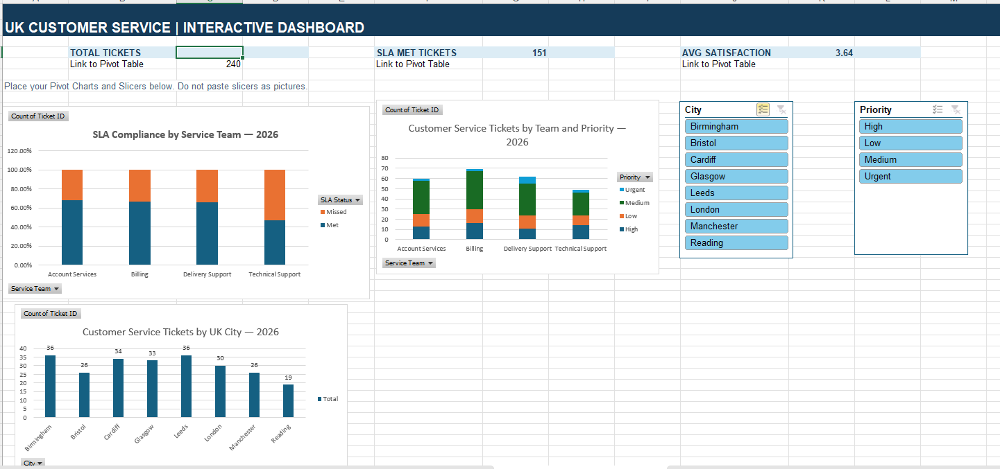

# uk-customer-service-excel-dashboard
UK Customer Service Data Analysis using Excel Pivot Tables, Pivot Charts, Slicers and Interactive KPIs
# UK Customer Service Performance Dashboard | Excel

## Project Overview
This project analyses 240 fictional UK customer service tickets using Microsoft Excel.

The objective is to understand customer service performance, ticket volumes, service team workload, SLA compliance and customer satisfaction.

## Tools and Skills Used
- Microsoft Excel
- Pivot Tables
- Pivot Charts
- Interactive Slicers
- Dynamic KPI Dashboard
- Data Analysis and Visualisation
- GitHub

## Key Performance Indicators

| KPI | Result |
|---|---|
| Total Customer Tickets | 240 |
| SLA Met Tickets | 151 |
| SLA Compliance Rate | 62.92% |
| SLA Missed Tickets | 89 |
| Average Customer Satisfaction | 3.64 / 5 |

## Analysis Performed

**1. Customer Tickets by City**

Analysed customer service ticket volumes across eight UK cities.

**2. Tickets by Service Team and Priority**

Compared ticket volumes across Account Services, Billing, Delivery Support and Technical Support, including High, Medium, Low and Urgent priority requests.

**3. SLA Compliance Analysis**

Compared the percentage of tickets meeting and missing SLA targets across service teams.

**4. Interactive Excel Dashboard**

Created a dashboard containing three Pivot Charts, dynamic KPIs, and City and Priority Slicers.

## Key Business Insights
- Billing handled the highest number of tickets (69).
- Birmingham and Leeds had the highest ticket volumes (36 each).
- Overall SLA compliance was 62.92%.
- Technical Support had the lowest SLA compliance (46.94%), suggesting an area for further investigation.

## Dashboard Screenshot

## Project Files
- `UK_Customer_Service_Pivot_Dashboard_Practice.xlsx` — Excel workbook with Pivot Tables, Pivot Charts, Slicers and KPI dashboard.
- `UK_Customer_Service_Dashboard.png` — Dashboard screenshot.

*All data used in this project is fictional and intended for learning and portfolio demonstration.*

Pivot Tables: Ticket volumes by city, team and priority.

Pivot Charts: Visual comparisons of customer service performance.

Slicers: Interactive filtering by city and priority.

Dynamic KPIs: Total tickets, SLA met tickets and average customer satisfaction.

GitHub: A separate project with your Excel workbook, dashboard screenshot and README.
